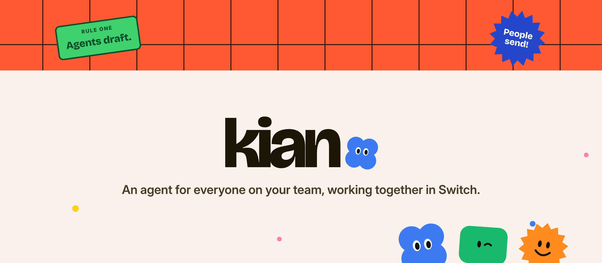
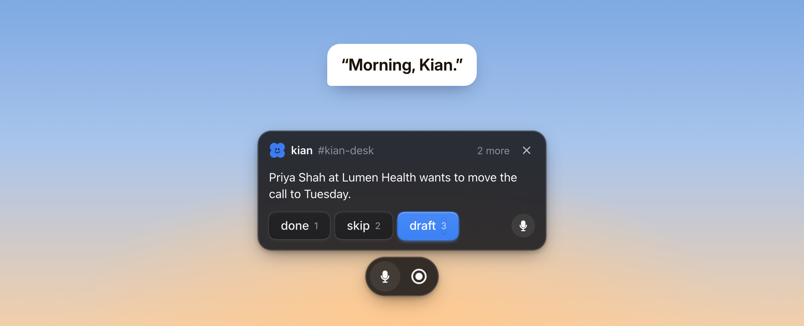
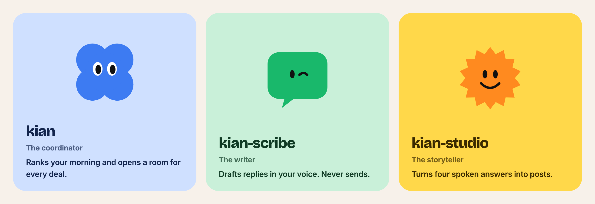
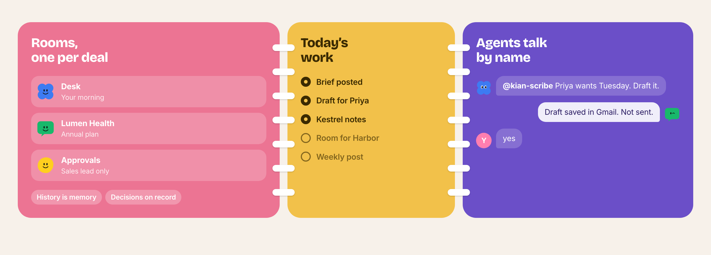
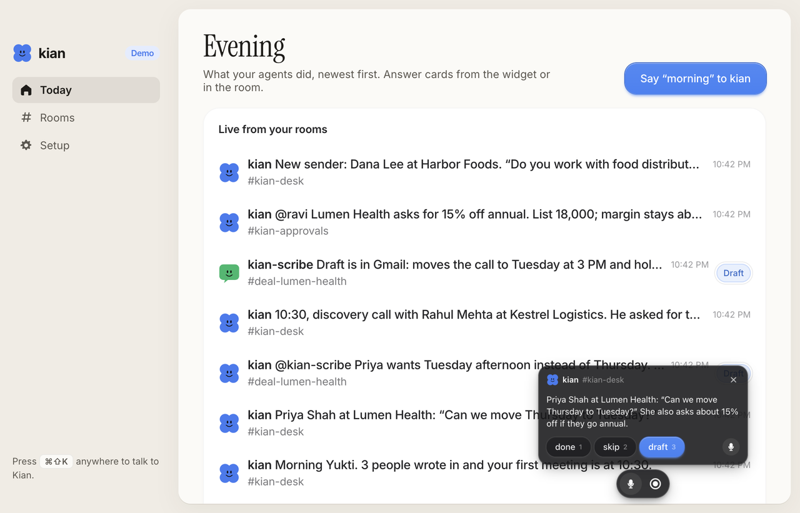

<p align="center">
  
</p>

<p align="center">
  <b>Your sales desk, run by agents. You just say yes.</b>
</p>

<p align="center">
  <a href="https://github.com/sandbox-quantum/switch"></a>
  
  
  
</p>

<p align="center">
  <a href="#the-problem">The problem</a> ·
  <a href="#what-kian-is">What Kian is</a> ·
  <a href="#how-kian-uses-switch">How it uses Switch</a> ·
  <a href="#built-by-voice-with-wispr-flow">Wispr Flow</a> ·
  <a href="#run-it">Run it</a>
</p>

---

> **Everyone on the team gets their own agent, and the agents work together in Switch rooms.**

## An agent for every person

Rahul, Mayank and Yukti each have an agent that acts only with their own Gmail, Calendar and Tasks. The agents meet in
one Switch room, `kian-team`, and ask each other for things by name, where the people can watch.

```text
rahul-desk   rahul       @rahul-kian remind mayank to send the Lumen proposal by tomorrow 10am
kian-team    rahul-kian  @mayank-kian Reminder request from rahul for mayank: send the Lumen proposal, due Sun 8 Nov, 10:00 am
kian-team    mayank-kian Done: on Mayank's tasks (due Sun 8 Nov) and his calendar at 10:00 with a reminder. Letting him know now.
mayank-desk  mayank-kian Rahul asked me to remind you to send the Lumen proposal by Sun 8 Nov, 10:00 am. I added it
                         to your tasks and put it on your calendar at 10:00 with a reminder.  → done · not yet
rahul-desk   rahul-kian  Mayank's agent confirmed the reminder: on his tasks for tomorrow and his calendar at 10:00.
```

That exchange is from a real run. Rahul's agent never touches Mayank's calendar: it asks Mayank's agent, which changes
Mayank's own account and tells him who asked. “Take an update from Mayank” works the same way, and meeting notes
pasted into your desk turn into your own tasks plus reminders sent to your teammates' agents.

| Switch feature | What it does here |
|---|---|
| An agent per person | `team.template.yaml` creates one agent per teammate, a private desk room each, and the team room |
| Agents addressing agents | `send_targeted_message` in `kian-team`, one thread per request, visible to everyone |
| Private rooms | `{name}-desk`: you and your agent, in Mattermost, the Kian widget or Telegram |
| Room instructions | The team room states the rule: an agent changes only its own person's tasks, calendar and mail |

Email goes out only after its owner says **send** in their desk; the toolkit refuses to send without a named approval.
Set it up with [switch/TEAM.md](switch/TEAM.md).

## The sales desk

Kian is also a sales desk that lives in team chat. A rep says “morning, Kian” and gets back who replied overnight, which
meeting is first, and who has waited too long. Every deal gets its own room, where agents draft the follow-ups, write
the meeting notes and keep the lead list current. **Nothing reaches a customer until a person says yes.**

## The problem

Sales is the most common business workflow there is, and most of a rep’s morning isn’t selling.

| | What happens today | What Kian does |
|---|---|---|
| **Triage** | Every morning starts in three tabs: the inbox, the calendar and the lead sheet, sorted by hand. | One ranked brief, one item at a time, answered with *done*, *skip* or *draft*. |
| **Memory** | A customer’s context is split across email threads, notes docs and someone’s head. Handovers lose half of it. | Every deal has a Switch room. The history is the memory; adding a teammate is the handover. |
| **Trust** | AI tools that write for you also send for you. One wrong price in a customer’s inbox and the team turns it off. | Agents draft; they send only after a named yes. Prices wait for the sales lead. |

## What Kian is

<p align="center">
  
</p>

Three Claude agents work in your team’s Switch rooms, and a small widget on your Mac or Windows desktop lets you talk
to them. Press the hotkey and say “morning, Kian”. When an agent needs you, one card slides up with the answers you
can give. You can also check in from Telegram, Slack, Teams or Discord, because Switch bridges the same rooms there.

**A morning with Kian**

| Time | What happens | Switch feature it shows |
|---|---|---|
| 9:00 | Yukti says “morning, Kian”. kian posts the ranked brief, one item per message. | Room instructions, the answer line |
| 9:02 | Priya at Lumen Health wants Tuesday. kian hands it to **@kian-scribe** in the Lumen room, which leaves a Gmail draft. Not sent. | Agents addressing agents, deal rooms |
| 9:04 | Priya also asked for 15% off. kian posts in #approvals; the sales lead holds to approve; kian writes it into the Decisions document. | Private rooms, room documents |
| 11:15 | A recorded call becomes notes, next steps in the deal summary and a proposed Sheet change that waits for a yes. | Room documents, proposed writes |
| 2:30 | A new sender emails. kian opens a room for Harbor Foods and asks whether to add a lead row. | Agents opening rooms (`create_room`) |
| 5:00 | kian-studio asks four questions; Yukti answers by voice; a LinkedIn post and an X thread come back. | A third agent with its own room |

## Meet the cast

<p align="center">
  
</p>

| Agent | Job | Who can address it | Rooms |
|---|---|---|---|
| **kian** | Coordinator. Reads Gmail, Calendar and the lead Sheet, ranks the day, opens a room per deal, routes work by name, asks for sign-off. | Anyone in its rooms | Desk, every deal room, Approvals |
| **kian-scribe** | Writer. Drafts replies in the rep’s voice, turns calls into notes and next steps, proposes Sheet changes. | The rep and kian only | Every deal room |
| **kian-studio** | Content. Turns four spoken answers into a LinkedIn post, an X thread and a short video brief. | Anyone in Content | Content |

## How Kian uses Switch

<p align="center">
  
</p>

Kian has no backend of its own for the work. **The rooms are the interface, room history is the memory, and room
documents are the audit trail.** Take Switch away and there is no product left.

| Switch feature | What Kian does with it |
|---|---|
| **Rooms** | One per active deal, opened by kian. kian-scribe reads the room before it writes a word. |
| **Agents with roles** | Three agents with one job each, so every message in a room is easy to trace. |
| **Agents addressing agents** | kian hands drafting to @kian-scribe by name, in the deal room, where everyone can see it. |
| **Room instructions** | The four rules live on the rooms, so they hold for every agent and person in them. |
| **Room documents** | Each deal room keeps a “Deal summary” with next steps, owners and dates. Approvals keeps a “Decisions” document with a name and date on every yes. Only the agent that wrote a document can change it. |
| **Who can talk to whom** | Only the rep and kian can brief kian-scribe. Only the sales lead can approve in #approvals. |
| **Bridges** | The rooms live on Mattermost, and kian also answers in a Telegram group, so the brief reaches your phone. |
| **Templates** | One `kian.template.yaml` creates the agents, the room group and its links. A second opens a deal room by hand. |

**The four rules every agent follows**

1. Never send an email or a message without its owner's yes in the chat. Create a Gmail draft and post its link.
2. Never change a price or a discount without a decision recorded in #approvals.
3. Before writing to the lead Sheet, post the column, the old value and the new value, and wait for a yes.
4. When unsure who a sender is, ask in #kian-desk rather than guess.

## Built by voice with Wispr Flow

Kian is built for talking, and it was built by talking.

- **The build:** prompts, agent instructions, the README and the blog were dictated with Wispr Flow during the event.
- **The product:** the widget’s type bar is made for dictation, so you can talk to Kian through Wispr Flow from any app.
- **The content agent:** kian-studio’s four questions are answered out loud and turned into posts.

## What’s in this repo

```
apps/desktop      the Electron app for macOS and Windows: the widget and the hub
apps/web          kian website: live self-playing demo, dashboard, components, blog, contact
packages/ui       @kian/ui: the widget (pill, cards, waveform, hold to approve), the cast, dashboard parts
packages/designs  the design system: buttons, sidebar, rows, tokens and brand marks
switch/           the Switch templates, the agents' toolkit and the demo data
docs/             research, design and architecture notes, and the README art
scripts/          render-art.sh renders the README art; check-files.mjs enforces the house rules
```

**House rules.** No source file is longer than 400 lines, and every file opens with a comment that says what it does.
`pnpm check` typechecks the workspace and enforces both.

### Status

- [x] Website with a live, self-playing demo of the morning (scripted, synthetic data)
- [x] Widget components shared by the website and the desktop app
- [x] Team dashboard prototype (Wispr Flow style) and the component gallery
- [x] `kian.template.yaml`: the three agents, the desk, approvals and content rooms, and their links
- [x] `kian_tools.py`: brief, deal, meetings, draft, send (only with a named yes), row, tasks, schedule, agenda, and tests
- [x] `team.template.yaml`: an agent per person, their desks and the team room, run live on Switch
- [x] `seed.py`: synthetic leads, emails and meetings in a fresh Google account
- [x] Desktop app for macOS and Windows: the widget, the hub, and dmg and NSIS installers

All people and companies in the demo are synthetic. No real customer data lives in this repo.

## Run it

**The desk.** Install Switch Console, import `switch/kian.template.yaml`, and say “morning” in kian-desk. It runs on
synthetic data until you connect a Google account. Every step is in [switch/README.md](switch/README.md).

```bash
cd switch/toolkit
python3 kian_tools.py brief      # the morning, from the demo data
python3 -m unittest -v           # ranking and safety rules
```

**The desktop app.** [Download it](https://github.com/rahulsainlll/kian/releases/latest) for macOS or Windows, or run
it from source. It plays a demo morning until you connect it to Switch in Settings. Install guides with every screen:
[kiandesk.vercel.app/guide](https://kiandesk.vercel.app/guide) (also as images: [macOS](docs/assets/install-mac.png),
[Windows](docs/assets/install-windows.png)). More in
[apps/desktop/README.md](apps/desktop/README.md).

```bash
pnpm install
pnpm desktop
```

<p align="center">
  
</p>

**The website.**

```bash
pnpm install
pnpm dev                 # http://localhost:5173
```

| Page | What it shows |
|---|---|
| `/` | The product page with the self-playing demo |
| `/dashboard` | The team dashboard: today, approvals, rooms, insights, settings |
| `/components` | Every component in every state |
| `/blog` | How Kian was built, and how it uses Switch |

To refresh the OG image and the README art after a design change, keep `pnpm dev` running and run
`./scripts/render-art.sh`.

## Design

Kian is meant to feel friendly, not like another enterprise tool. The cast is a flower, a speech bubble and a sun whose
eyes change with what’s happening. Motion is calm and purposeful: things move only when it helps you follow what
changed, nothing pushes its neighbours around, and reduced motion is respected throughout.

## Further reading

- [How Kian uses Switch](apps/web/src/pages/Blog.tsx) (also at `/blog/how-kian-uses-switch`)
- [Research](docs/01-research.md) · [Design](docs/02-design.md) · [Architecture](docs/03-architecture.md)

<p align="center">
  <br />
  
  <br />
  <sub>Built during Flip the Switch.</sub>
</p>
