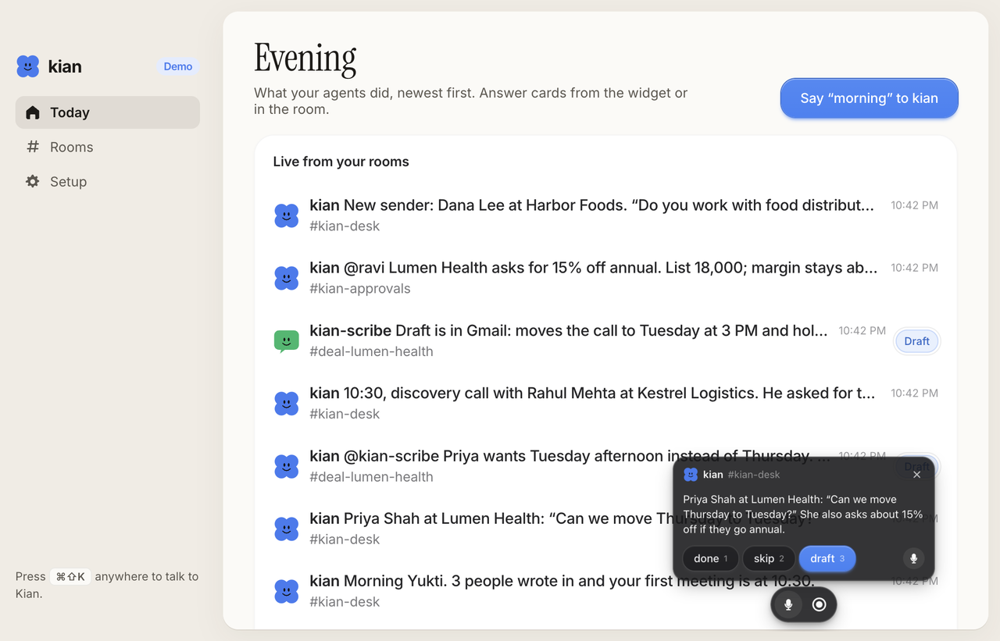
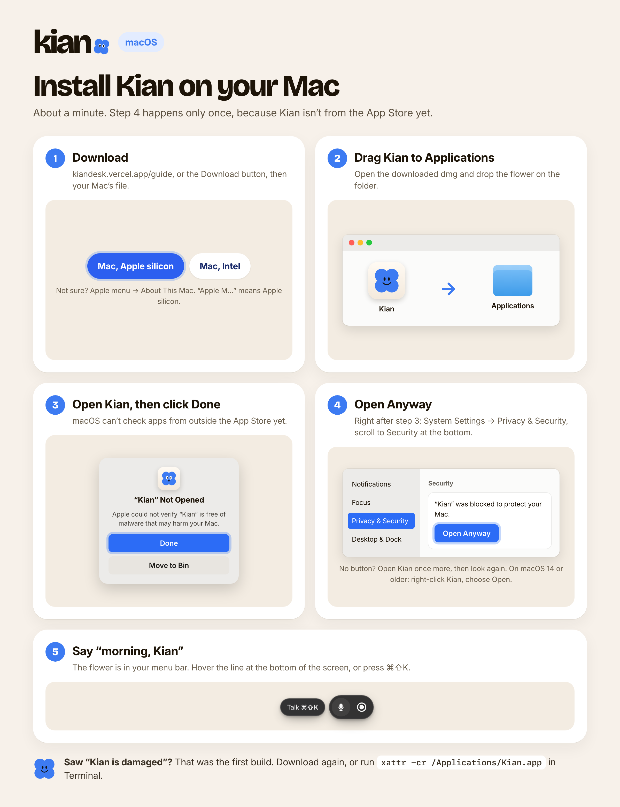
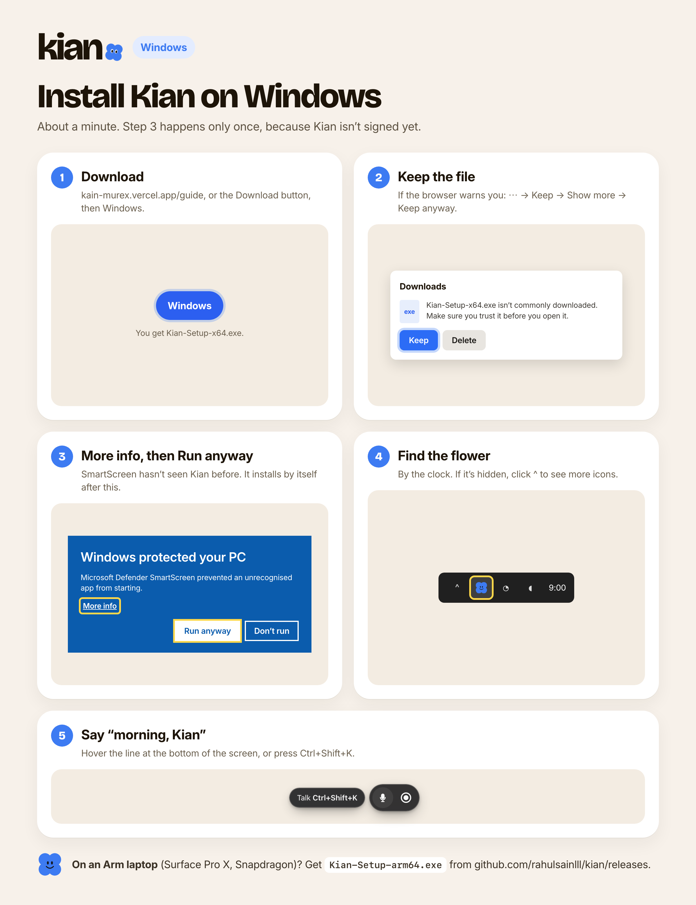

# Kian for macOS and Windows

The widget and the hub: one more client of your Switch rooms. It signs in to the same Mattermost as you, shows one agent
message at a time with the answers it offers, and posts what you say or tap back into the room. It keeps no work of its
own.



## Download

Get the latest build from [GitHub Releases](https://github.com/rahulsainlll/kian/releases/latest): a dmg for Apple
silicon or Intel Macs, and an installer for Windows.

The builds are not signed with an Apple Developer ID yet, so the first launch needs one extra step. These two guides
show every screen. Send people to [kiandesk.vercel.app/guide](https://kiandesk.vercel.app/guide), or share the
images:

| macOS | Windows |
|---|---|
|  |  |

In short:

- **macOS:** drag Kian to Applications and open it. When macOS says it can't verify the developer, open **System
  Settings → Privacy & Security**, scroll down and choose **Open Anyway**. (On macOS 14 and earlier, right-click the
  app and choose Open.)
- **Windows:** when SmartScreen appears, choose **More info**, then **Run anyway**.

If macOS says Kian **is damaged**, you have the first v0.1.0 build, which wasn't signed correctly. Download the
latest release, or clear the download flag on the copy you have:

```bash
xattr -cr /Applications/Kian.app
```

## Run it from source

```bash
pnpm install
pnpm desktop          # from the repo root
```

It opens on a **sample morning**, with no server needed. Press <kbd>⌘⇧K</kbd> (<kbd>Ctrl+Shift+K</kbd> on Windows) or
click **Say “morning” to kian** in the hub, then answer the cards.

To use your real desk, open **Setup** in the hub, choose **Switch (Mattermost)**, and enter:

- **Mattermost URL**: shown in Switch Console under Messaging apps, usually `http://localhost:8065`.
- Your **username and password**, or a **personal access token** with the username left empty.
- **I'm the sales lead**, if approval cards are for you.

**Test connection** signs in and says who you are.

Everything else is under **Settings** in the hub, or the flower in your menu bar:

- **Shortcut**: click it and press the keys you want.
- **Widget position**: bottom centre, a bottom corner, or upright on the left or right edge. At rest it is a thin line;
  hover and it grows into the pill.
- **Sounds**: soft tones when Kian listens, sends, or has a card for you.
- **Voice engine** (Agents tab): type or dictate with Wispr Flow, OpenAI, Groq Whisper, NVIDIA Whisper, or any server
  with an OpenAI-style `/audio/transcriptions` route.

### NVIDIA Whisper

Run NVIDIA's speech NIM with Whisper large v3 on a machine with an NVIDIA GPU (see NVIDIA's
[speech NIM guide](https://docs.nvidia.com/nim/speech/latest/get-started/tutorials/asr.html)). It serves
`/v1/audio/transcriptions` on port 9000. Pick **NVIDIA Whisper** in the Agents tab and set the endpoint to that
machine, for example `http://gpu-box:9000/v1`. Kian sends 16 kHz WAV, which the NIM accepts.

## How it works

| Piece | File | |
|---|---|---|
| Rooms | `src/main/rooms/mattermost.ts` | REST and WebSocket, signed in as you. `mock.ts` plays the demo |
| Desk | `src/main/desk.ts` | Which messages become cards, the queue, answers posted as thread replies |
| Answer line | `src/shared/answers.ts` | `→ done · skip · draft` at the end of an agent message becomes buttons |
| Widget | `src/renderer/widget/` | The shared `KianWidget` from `@kian/ui`, voice recording, click-through |
| Hub data | `src/renderer/hub/` | Turns room events into the hub's data, and the settings tabs |
| Settings | `src/main/settings.ts` | Plain values in `settings.json`; the token and the voice key go in the OS keychain |
| Hub | `@kian/hub` | The website's dashboard component, filled from the rooms |

Voice: with a voice engine chosen, the mic records, converts to WAV and sends it to that engine. With **Type or
dictate**, the mic opens the type bar, which is where Wispr Flow or your system's dictation types for you.

## Build installers

```bash
pnpm --filter @kian/desktop dist:mac    # dmg for Apple silicon and Intel, in apps/desktop/release
pnpm --filter @kian/desktop dist:win    # NSIS installer (build on Windows, or with Wine)
```

Mac builds are signed ad hoc, which gives the whole app a valid signature so macOS treats it as from an unidentified
developer rather than damaged. To sign with an Apple Developer ID and notarize, add these repository secrets and the
release workflow uses them: `MAC_CERT_P12_BASE64` (the certificate as base64), `MAC_CERT_PASSWORD`, `APPLE_ID`,
`APPLE_APP_SPECIFIC_PASSWORD` and `APPLE_TEAM_ID`. Notarized builds open with no extra step.

**Releasing.** Pushing a tag that matches the version in `package.json` (for 0.1.0, `v0.1.0`) runs
`.github/workflows/desktop-release.yml`, which builds both platforms and publishes the release the website links to.

## Checks

```bash
pnpm --filter @kian/desktop test        # the answer-line parser
pnpm --filter @kian/desktop build && KIAN_CAPTURE=/tmp/kian pnpm --filter @kian/desktop exec electron .
# plays a morning on its own and saves each window as a PNG
```
